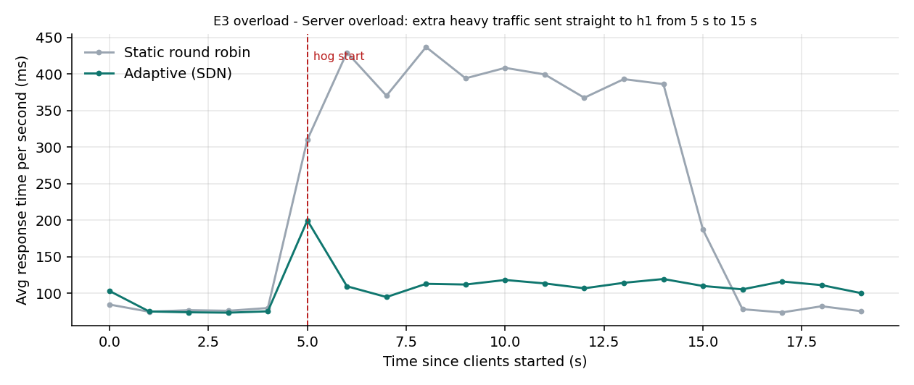
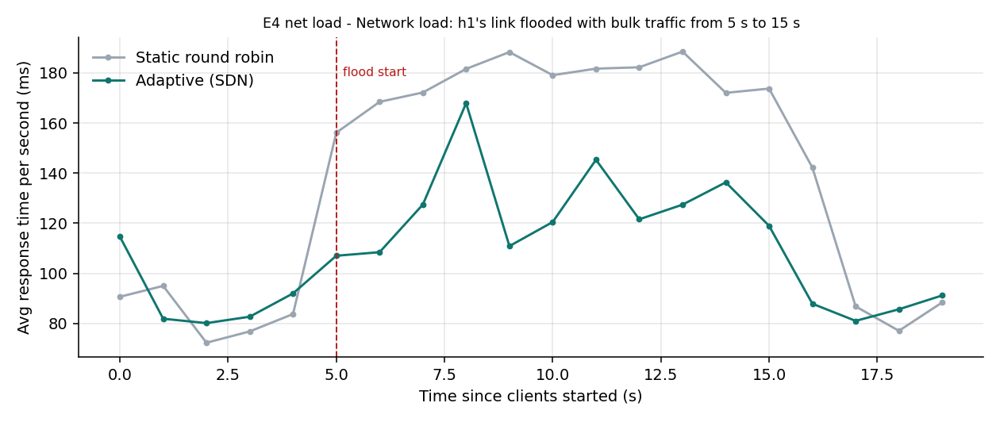
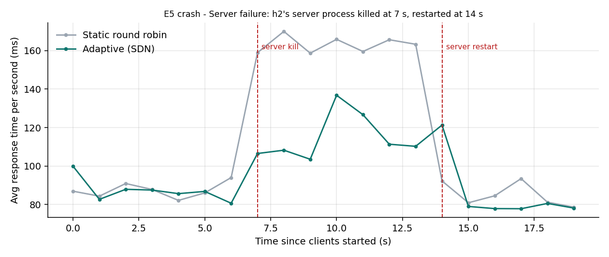
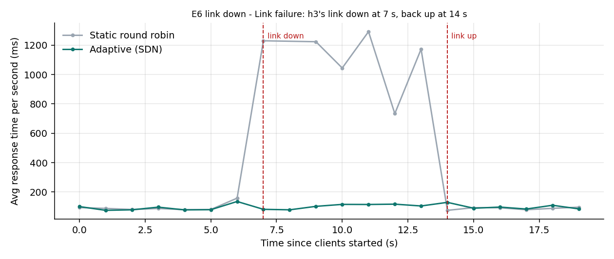
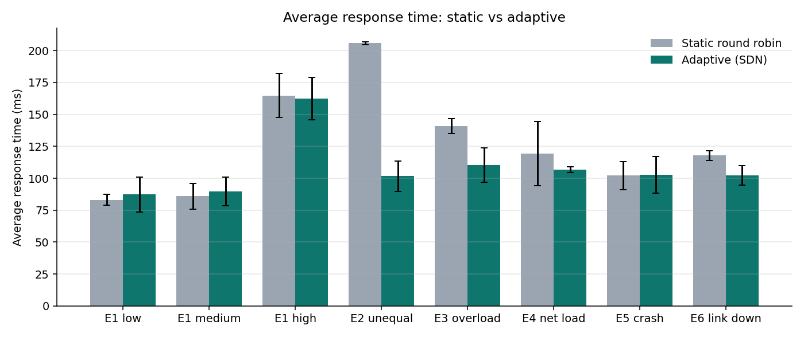
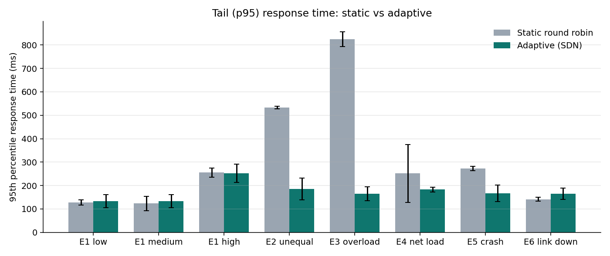
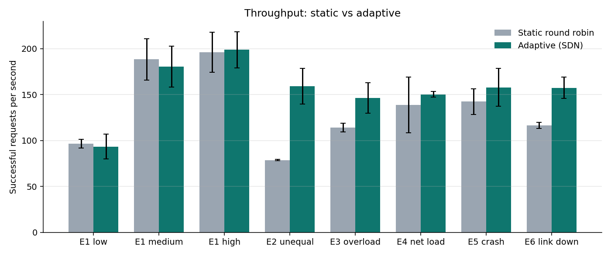
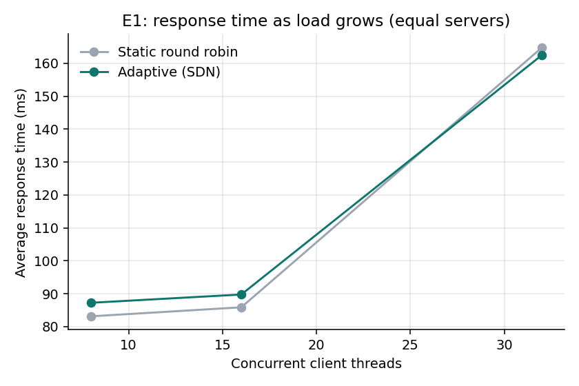
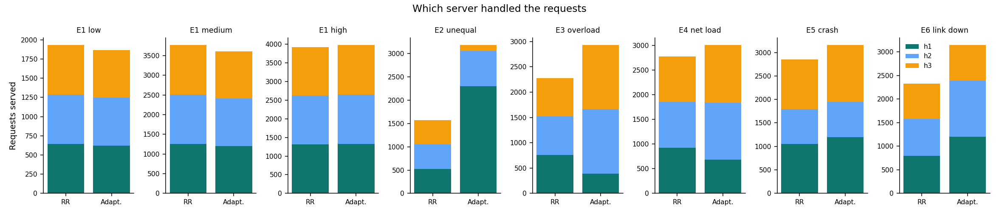
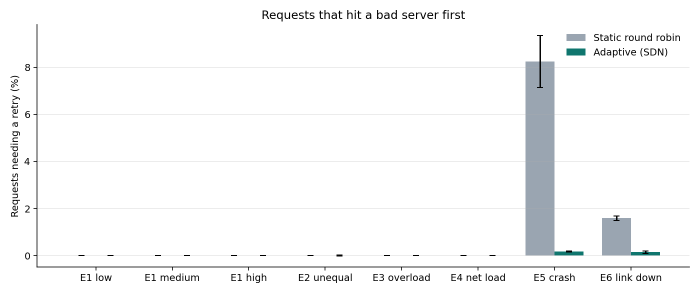

# D2 Report: Adaptive Load Balancer with SDN

CN mini project #20, Deliverable 2 (25 marks).
The complete system, dynamic SDN behaviour, failure and overload
scenarios, and the evaluation of static round robin against adaptive.

| Rubric item | Marks | Where |
|---|---|---|
| Complete application functionality | 4 | [section 1](#1-complete-application-functionality) |
| Dynamic SDN functionality | 6 | [section 2](#2-dynamic-sdn-functionality) |
| Challenging scenario / robustness | 4 | [section 3](#3-challenging-scenarios-and-robustness) |
| Performance evaluation & comparison | 5 | [section 4](#4-performance-evaluation-static-vs-adaptive) |
| Documentation, final demo, viva | 6 | [section 5](#5-documentation-and-demo), [README](../README.md) |

D1 (architecture, sockets, topology, first tests) is in
[D1_report.md](D1_report.md).

---

## 1. Complete application functionality

Every requirement of project #20 works end to end in Mininet with POX:

| Requirement | Done by | Shown in |
|---|---|---|
| Multiple TCP application servers | 3 multi-threaded servers with worker limits and queueing | all scenarios |
| Concurrent client requests | 4 client hosts x 8–32 threads, a new TCP connection per request | all scenarios |
| Monitor server load | `LOAD` reports over TCP every 0.5 s | `load` events, E2, E3 |
| Monitor network load | port statistics every 1 s, converted to link utilisation | `port_stats` events, E4 |
| Distribute flows using SDN | per-connection rewrite rules chosen by the controller | `assign` events, flow dumps |
| Detect overloaded servers | response time / queue (relative to peers) / link use, with hysteresis | E3, E4 |
| Detect server failures | report socket closed, 2 s heartbeat, PortStatus | E5, E6 |
| Compare static and adaptive | same scenarios, `--mode=rr` vs `--mode=adaptive`, 3 repetitions | section 4 |

## 2. Dynamic SDN functionality

The controller changes how the network forwards traffic while it runs,
based on what it measures:

1. **Per-connection placement.** Every new TCP connection to the VIP is a
   PacketIn. The controller computes a cost for each healthy server:
   ```
   cost(s) = (estimated connections on s + 1) / workers(s) x svc_ms(s)
             x (1 + 4 x link_utilisation(s)^2)   x 3 if s is overloaded
   ```
   It then installs forward and reverse rewrite rules to the cheapest
   server. The traffic split changes from moment to moment with the
   load. In E2 the fast server gets 72 % of the connections and the
   slow one 4 %. See the `assign` events: each carries the cost of every
   server at that instant.
2. **Live load estimate between reports.** Reports come every 0.5 s. In
   that time a server finishes dozens of requests. The controller keeps
   its own estimate: it starts from the reported `active` count, adds
   each connection it sends, and subtracts the expected completions
   (`busy workers / svc_ms` per second). Each report resets the estimate
   to the truth.
3. **Network-aware.** Port statistics turn into link utilisation. A busy
   link makes a server expensive, even when the server itself is idle (E4).
4. **Overload detection with hysteresis.** A server is overloaded when its
   response time is above 250 ms or its queue is longer than 2 x workers,
   **and** it is clearly worse than the other servers (more than 1.5x their
   response time, or a queue longer than theirs plus one worker's worth).
   A link over 80 % busy also counts. It returns to normal below 70 % of
   the thresholds, or once it is no worse than its peers.
5. **Failure handling with flow deletion.** When a server fails, the
   controller sends `OFPFC_DELETE` FlowMods that remove every rule for it
   (reverse rules by `nw_src`, forward rules per tracked connection).
   Clients with open connections to the dead server then see a reset or
   timeout quickly and retry, and their retry is placed on a live server.
   When the server comes back (reports resume, or the port comes up), it
   rejoins automatically.
6. **Event log.** All of this is logged as JSON lines
   (`controller_events.jsonl`): `assign`, `load`, `port_stats`, `state`,
   `overloaded`, `normal`, `server_down`, `server_up`, `flows_deleted`.

## 3. Challenging scenarios and robustness

Each scenario runs 20 s with 4 client hosts. The event happens at a fixed
time while the clients keep sending.

| Scenario | What is done | Clients |
|---|---|---|
| E3 overload | h7 sends heavy requests (400 ms extra work, 8 threads) **straight to h1's own IP** from 5 s to 15 s. This load bypasses the VIP, so the controller can only see it through h1's reports. | 16 threads |
| E4 network load | h1 sends bulk TCP traffic to h7 (4 streams) from 5 s to 15 s, saturating h1's 10 Mbit/s link. h1's CPU is idle, only its link is busy. | 16 threads |
| E5 server crash | h2's server process is killed at 7 s and restarted at 14 s | 16 threads |
| E6 link failure | the s1–h3 link is set down at 7 s and up again at 14 s | 16 threads |

### How fast the controller noticed (mean of 3 runs)

| Scenario | Event | Mode | Controller event | Detected after (s) | Reason logged |
|---|---|---|---|---|---|
| E3 overload | hog_start | Adaptive (SDN) | h1 overloaded | 0.45 | queue 15 > 2.0 x 4 workers |
| E3 overload | hog_start | Static round robin | h1 overloaded | 0.47 | queue 18 > 2.0 x 4 workers |
| E4 net load | flood_start | Adaptive (SDN) | h1 overloaded | 1.40 | link 85% > 80% |
| E4 net load | flood_start | Static round robin | h1 overloaded | 1.49 | link 94% > 80% |
| E5 crash | server_kill | Adaptive (SDN) | h2 server_down | 0.01 | report connection closed |
| E5 crash | server_kill | Static round robin | h2 server_down | 0.02 | report connection closed |
| E5 crash | server_restart | Adaptive (SDN) | h2 server_up | 0.08 | load reports received |
| E5 crash | server_restart | Static round robin | h2 server_up | 0.08 | load reports received |
| E6 link down | link_down | Adaptive (SDN) | h3 server_down | 0.05 | switch port down |
| E6 link down | link_down | Static round robin | h3 server_down | 0.05 | switch port down |
| E6 link down | link_up | Adaptive (SDN) | h3 server_up | 0.27 | load reports received |
| E6 link down | link_up | Static round robin | h3 server_up | 0.33 | load reports received |

### What the clients experienced

| Scenario | Mode | Reps | Avg ms | p95 ms | Throughput req/s | Failed % | Retried % | h1 / h2 / h3 requests |
|---|---|---|---|---|---|---|---|---|
| E3 overload | Static round robin | 3 | 140.8 | 824.8 | 114.0 | 0.00 | 0.00 | 760 / 759 / 760 |
| E3 overload | Adaptive (SDN) | 3 | 110.5 | 165.1 | 146.5 | 0.00 | 0.00 | 393 / 1269 / 1268 |
| E4 net load | Static round robin | 3 | 119.2 | 251.6 | 138.7 | 0.00 | 0.00 | 927 / 924 / 924 |
| E4 net load | Adaptive (SDN) | 3 | 106.7 | 183.4 | 150.3 | 0.00 | 0.00 | 683 / 1157 / 1165 |
| E5 crash | Static round robin | 3 | 102.1 | 272.2 | 142.4 | 2.55 | 8.24 | 1052 / 744 / 1053 |
| E5 crash | Adaptive (SDN) | 3 | 102.8 | 166.4 | 157.9 | 0.00 | 0.17 | 1198 / 749 / 1211 |
| E6 link down | Static round robin | 3 | 117.9 | 141.3 | 116.4 | 0.43 | 1.60 | 792 / 792 / 744 |
| E6 link down | Adaptive (SDN) | 3 | 102.3 | 165.0 | 157.3 | 0.00 | 0.15 | 1199 / 1192 / 756 |

What happened in each scenario:

* **E3 overload.** The heavy requests go to h1's own IP, so the
  controller never placed them. It still noticed within 0.45 s, through
  h1's report (queue 15 > 8), and new VIP connections moved away from h1:
  393 requests on h1 against about 1270 on each of the others. Round
  robin kept sending a third of the traffic into h1's queue. Its p95
  latency was **825 ms against 165 ms** (80 % lower with adaptive).
* **E4 network load.** h1's CPU was idle; only its link was full. Port
  statistics showed the link at 85–94 % within 1.4 s: one 1 s statistics
  interval, plus the time to fill the link. Adaptive moved connections
  to h2 and h3 (683 against about 1160 each) and cut p95 latency from
  252 to 183 ms. Round robin cannot see network load at all.
* **E5 server crash.** The kill was seen in **10–20 ms**, because h2's
  report TCP connection closed. Adaptive deleted h2's flow rules and
  sent nothing more to it until it came back (seen 80 ms after the
  restart). Round robin kept sending every third connection to the dead
  server: **2.55 % of requests failed even after a retry, and 8.2 % needed
  a retry**. With adaptive, 0 % failed and 0.17 % needed a retry: only
  the connections that were open at the moment of the crash.
* **E6 link failure.** PortStatus reported the link down in 50 ms. With
  round robin, the connections sent to h3 waited for the 2 s client
  timeout. That shows as **p99 latency of 1899 ms** (adaptive 280 ms),
  0.43 % failed requests and 35 % less throughput, because client
  threads sat waiting. Adaptive's p95 is a little higher (165 against
  141 ms) because it puts all the load on the two remaining servers,
  whose queues are longer. Round robin's p95 hides the 2 s waits,
  since only 1.6 % of its requests had them (below the 5 % that p95
  ignores).

In both modes the controller detected every event equally fast.
Monitoring is the same in both; only adaptive mode uses it to change
the flow rules.

Timelines (average response time per second, both modes):

| | |
|---|---|
|  |  |
|  |  |

## 4. Performance evaluation: static vs adaptive

**Method.** Every scenario was run 3 times in each mode on the same VM.
Each run: fresh POX + Mininet, 3 servers with 4 workers each, 4 client
hosts starting at the same moment, 20 s of traffic, 2000-byte replies.
Latency = time from the client's connect until the full reply (including
a retry if one was needed). Numbers are means over the 3 runs. Per-run
values are in [runs.csv](../results/d2/runs.csv), mean and standard
deviation in [summary.csv](../results/d2/summary.csv).

| Scenario | Setup |
|---|---|
| E1 low / medium / high | equal servers (50 ms per request), 8 / 16 / 32 client threads |
| E2 unequal | h1 20 ms, h2 50 ms, h3 150 ms per request, 16 threads |
| E3–E6 | see section 3 |

| Scenario | Mode | Reps | Avg ms | p95 ms | Throughput req/s | Failed % | Retried % | h1 / h2 / h3 requests |
|---|---|---|---|---|---|---|---|---|
| E1 low | Static round robin | 3 | 83.1 | 127.0 | 96.6 | 0.00 | 0.00 | 644 / 644 / 644 |
| E1 low | Adaptive (SDN) | 3 | 87.3 | 132.9 | 93.4 | 0.00 | 0.00 | 622 / 626 / 620 |
| E1 medium | Static round robin | 3 | 85.9 | 124.0 | 188.5 | 0.00 | 0.00 | 1256 / 1257 / 1257 |
| E1 medium | Adaptive (SDN) | 3 | 89.8 | 133.4 | 180.4 | 0.00 | 0.00 | 1204 / 1210 / 1194 |
| E1 high | Static round robin | 3 | 164.8 | 255.6 | 196.2 | 0.00 | 0.00 | 1310 / 1308 / 1307 |
| E1 high | Adaptive (SDN) | 3 | 162.5 | 252.6 | 198.8 | 0.00 | 0.00 | 1323 / 1326 / 1326 |
| E2 unequal | Static round robin | 3 | 205.9 | 532.9 | 78.7 | 0.00 | 0.00 | 525 / 525 / 525 |
| E2 unequal | Adaptive (SDN) | 3 | 101.6 | 185.7 | 159.2 | 0.00 | 0.01 | 2300 / 753 / 130 |
| E3 overload | Static round robin | 3 | 140.8 | 824.8 | 114.0 | 0.00 | 0.00 | 760 / 759 / 760 |
| E3 overload | Adaptive (SDN) | 3 | 110.5 | 165.1 | 146.5 | 0.00 | 0.00 | 393 / 1269 / 1268 |
| E4 net load | Static round robin | 3 | 119.2 | 251.6 | 138.7 | 0.00 | 0.00 | 927 / 924 / 924 |
| E4 net load | Adaptive (SDN) | 3 | 106.7 | 183.4 | 150.3 | 0.00 | 0.00 | 683 / 1157 / 1165 |
| E5 crash | Static round robin | 3 | 102.1 | 272.2 | 142.4 | 2.55 | 8.24 | 1052 / 744 / 1053 |
| E5 crash | Adaptive (SDN) | 3 | 102.8 | 166.4 | 157.9 | 0.00 | 0.17 | 1198 / 749 / 1211 |
| E6 link down | Static round robin | 3 | 117.9 | 141.3 | 116.4 | 0.43 | 1.60 | 792 / 792 / 744 |
| E6 link down | Adaptive (SDN) | 3 | 102.3 | 165.0 | 157.3 | 0.00 | 0.15 | 1199 / 1192 / 756 |

Difference (positive = adaptive better):

| Scenario | Avg latency | p95 latency | Throughput |
|---|---|---|---|
| E1 low | -5% | -5% | -3% |
| E1 medium | -5% | -8% | -4% |
| E1 high | +1% | +1% | +1% |
| E2 unequal | +51% | +65% | +102% |
| E3 overload | +22% | +80% | +29% |
| E4 net load | +10% | +27% | +8% |
| E5 crash | -1% | +39% | +11% |
| E6 link down | +13% | -17% | +35% |








### Discussion

**Where adaptive wins, and by how much.** Whenever servers differ, or
something goes wrong, adaptive is clearly better:

* **E2 (unequal servers): latency halved, throughput doubled** (avg 206
  to 102 ms, p95 533 to 186 ms, 79 to 159 req/s). Adaptive gave 72 % of
  the connections to the fast h1, 24 % to h2 and 4 % to the slow h3,
  roughly in proportion to their speeds. Round robin gave each a third,
  so h3's queue set the pace for everyone.
* **E3 / E4 (one overloaded server / one busy link)**: p95 80 % and 27 %
  lower, throughput 29 % and 8 % higher.
* **E5 / E6 (failures)**: no failed requests at all, against 2.6 % and
  0.4 % with round robin; throughput 11 % and 35 % higher; the 2 s timeout
  tail (p99) disappears.

**Equal servers (E1): a tie.** When all servers are identical and the
load is steady, round robin is already a perfect split, so adaptive can
only match it, not beat it. At high load (32 threads) they are equal
(162 against 165 ms, 199 against 196 req/s). At low and medium load
adaptive is about 4 ms slower (5 %). That is well inside the
run-to-run spread (standard deviation 10–14 ms, see summary.csv), so it
is not a significant difference. Adaptive's estimate between reports is
good but not exact, and occasionally two requests land on the same
server where round robin would have spread them.

**What the comparison shows.** A static policy is fine only as long as
nothing changes. In any realistic situation (unequal machines, a hot
spot, a congested link, a crash) the controller's live view of server
and network load turns into lower latency, higher throughput and zero
failed requests. With this design it costs nothing measurable when
everything is equal.

**Detection speed.** Crash 0.01–0.02 s (socket closed), link down 0.05 s
(PortStatus), server overload 0.45 s (next load report), network
overload 1.4 s (port statistics interval). Faster network detection is
possible with a shorter statistics interval, at the cost of more
control traffic.

## Design decisions

**Why rewrite rules and not a proxy.** The friend's first version
(`legacy/proxy_load_balancer.py`) was a user-space HTTP proxy. All traffic
went through one Python process, and there was no SDN. Now only one packet
per connection reaches the controller, and the switch carries the data.

**Why per-connection rules (exact match on the 5-tuple).** All packets of
one TCP connection must reach the same server. Exact-match rules
guarantee this, and they time out by themselves (10 s idle).

**Why the servers report over TCP instead of the controller probing
them.** A report every 0.5 s costs one small message and carries numbers
only the server knows: queue length, service time. When a server process
dies, its TCP connection closes immediately, which is the fastest
possible failure signal (about 10 ms in E5).

**Problems found in the first version, and the fixes.** The first full
run (same scenarios) showed adaptive losing to round robin when all
servers were equal:

| First version, mean of 3 runs | RR avg ms | Adaptive avg ms | RR req/s | Adaptive req/s |
|---|---|---|---|---|
| E1 high (32 threads, equal servers) | 162.9 | 210.2 | 197.3 | 155.5 |
| E1 medium (16 threads) | 86.0 | 101.2 | 188.9 | 163.0 |

The controller's event log showed two causes:

1. **Stale estimate.** The first version estimated a server's load as
   "active at last report + connections sent since". It never subtracted
   finished connections, so a server that had not reported for 0.4 s
   looked far busier than it was. The server that reported most recently
   looked idle and got a burst of connections (the log shows one server's
   cost dropping from 698 to 172 at a report, then taking every new
   connection). Fix: subtract the expected completions (section 2,
   point 2).
2. **Overload flags that would not clear.** At high load every server
   is busy. Whichever reported a long queue first was flagged
   overloaded and **completely excluded**. An excluded server gets no
   requests, so its 2-second average response time never improves, and
   it stayed excluded while the other two were overwhelmed (18
   overloaded/normal flips in one run). Fixes: (a) a server only counts
   as overloaded when it is clearly worse than its peers, because when
   all are equally busy moving traffic cannot help; (b) overloaded
   servers are penalised (x3 cost), not cut off, so they keep receiving
   a little traffic and can show they recovered. Failed servers are still
   cut off completely.

The fixes were first checked on the development machine with real sockets
(the same server and client programs, and a small proxy calling the same
decision code). With equal servers and 32 threads, adaptive went from
167 ms / 190 req/s (round robin 134 ms / 238 req/s) to 134 ms / 237 req/s.
The fixes were then confirmed in Mininet with the results above.

**Unit tests cover these cases.** `tests/test_lb_core.py` has regression
tests `test_fresh_report_does_not_attract_a_burst`,
`test_equally_busy_pool_is_not_flagged` and
`test_overloaded_server_still_gets_a_trickle`.

**Limitations.**
* One switch. With several switches the same rules would be installed
  along the path; POX's `discovery` could provide the topology.
* The servers are simulated workloads (a sleep per request). Real servers
  would report the same metrics.
* The controller is a single point of failure (normal for one POX
  instance).
* Rules are per connection, so a very high connection rate means many
  PacketIns. Wildcard rules per client would scale better but react slower.

## 5. Documentation and demo

* **Reproduce everything**: `bash run_all.sh` (see [README](../README.md#5-how-to-run)).
  It installs dependencies, runs the 26 unit tests, 9 socket tests, 10 D1
  Mininet tests and 48 D2 runs, and writes all tables and graphs.
* **Live demo**: `sudo python3 demo.py` plus `python3 experiments/watch.py`.
  The demo prints the commands for each scenario (overload, link flood,
  crash, link down).
* **Test cases**: `tests/` (unit, socket, D1 end-to-end) and
  `experiments/run_d2.py` (all D2 scenarios, with the exact parameters in
  [results/d2/scenarios.json](../results/d2/scenarios.json)).
